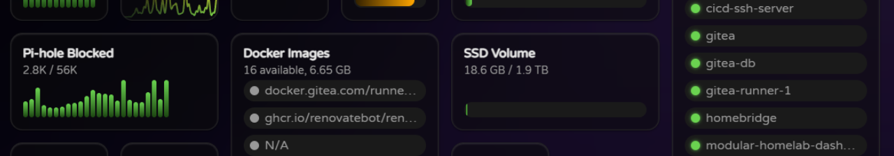

# Chatty Plugin

The Chatty plugin allows you to monitor your Chatty AI chat instance directly from the dashboard. It fetches aggregate statistics such as conversation counts, proxy requests, provider and model counts, and a daily conversation heatmap.

The statistics endpoint is publicly accessible, so no authentication is required. You only need to configure the Chatty URL in the config.yaml file:

```yaml
plugins:
  chatty:
    url: https://your-chatty-instance.com
```

## Data Points

- `conversations` - Total number of conversations across all users
- `proxy-requests` - Total number of AI proxy requests
- `providers` - Number of configured LLM providers
- `models` - Total number of available models
- `custom-mappings` - Number of custom model mappings
- `conversations.daily` - 365-day daily conversation heatmap

## Example Configuration

```yaml
widgets:
  # Show total conversation count
  - type: datawidget
    subtype: fill
    title: Conversations
    datasource: chatty
    datapoint: conversations
    width: 1

  # Show total proxy requests
  - type: datawidget
    subtype: fill
    title: Proxy Requests
    datasource: chatty
    datapoint: proxy-requests
    width: 1

  # Show daily conversation heatmap
  - type: datawidget
    subtype: heatmap
    title: Daily Conversations
    datasource: chatty
    datapoint: conversations.daily
    width: 2
```